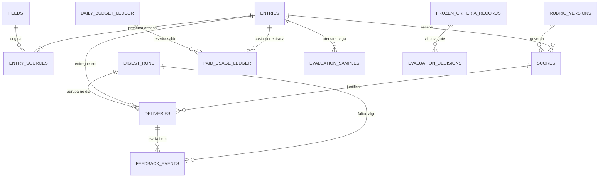
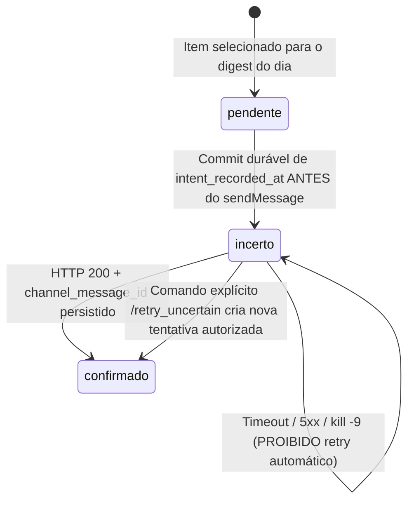

# Phase 1 Data Model: Feed Curator V1 — Curadoria diária de feeds

**Feature**: `001-feed-curation-v1` | **Date**: 2026-11-01
**Storage Strategy**: SQLAlchemy 2.0 Core + Alembic (neutro de dialeto via `DATABASE_URL`; padrão provisório SQLite em volume nomeado com `WAL` + `synchronous=FULL` conforme `docs/adr/0001-armazenamento-do-estado.md`)

Nenhum tipo exclusivo de motor (`JSONB`, `ARRAY`, `TSVECTOR`) é utilizado no esquema da V1 para preservar compatibilidade integral entre SQLite (Opção A) e PostgreSQL (Opção B1/B2). Todos os valores monetários são persistidos em **micro-dólares inteiros** (`1 USD = 1_000_000 micro_usd`) para eliminar erros de arredondamento em reservas atômicas (FR-019, SC-004). Todos os carimbos de tempo são armazenados em UTC ISO-8601 / `TIMESTAMP WITH TIME ZONE`, enquanto chaves diárias de digest e orçamento (`YYYY-MM-DD`) são calculadas explicitamente no fuso configurado (`America/Sao_Paulo`, FR-012, FR-019, FR-022).

---

## 1. Visão Geral de Relacionamentos

---

## 2. Entidades Persistentes (Banco de Estado)

### 2.1 `feeds` (*Key Entity: Feed*)

Representa uma fonte RSS/Atom cadastrada por OPML ou comando.

| Campo | Tipo Neutro | Obrigatório | Regra / Restrição |
|---|---|---|---|
| `id` | `Integer` (PK) | Sim | Auto-incremento |
| `xml_url` | `String(2048)` | Sim | `UNIQUE`; URL normalizada do feed (idempotência de FR-001/FR-003) |
| `site_url` | `String(2048)` | Não | URL do site de origem quando conhecida |
| `title` | `String(512)` | Sim | Título exibido ao usuário |
| `category` | `String(255)` | Não | Categoria preservada no round-trip OPML (FR-001, FR-002) |
| `state` | `String(32)` | Sim | `active`, `paused`, `disabled`, `removed` (FR-005, FR-007) |
| `prior_weight` | `Numeric(4, 2)` | Sim | Padrão `1.00`, intervalo `[-1.00, 2.00]`; alimenta apenas a regra simples (FR-005) |
| `etag` | `String(512)` | Não | Validador HTTP `ETag` (FR-008) |
| `last_modified` | `String(255)` | Não | Validador HTTP `Last-Modified` (FR-008) |
| `consecutive_failures` | `Integer` | Sim | Padrão `0`; pausa automática ao atingir `MAX_FEED_FAILURES` (FR-007) |
| `next_fetch_after` | `DateTime` | Não | Janela de backoff exponencial após falha recuperável (FR-008) |
| `last_error` | `Text` | Não | Resumo sanitizado da última falha (sem segredos) |
| `activated_at` | `DateTime` | Sim | Momento da ativação atual |
| `baseline_completed_at` | `DateTime` | Não | Preenchido após o 1º ciclo que marca itens pré-existentes como "já vistos" (FR-004) |
| `created_at` / `updated_at` | `DateTime` | Sim | Auditoria temporal |

---

### 2.2 `entries` e `entry_sources` (*Key Entity: Entrada*)

Representa uma publicação deduplicada exata e todas as suas fontes de origem.

**Tabela `entries`**:

| Campo | Tipo Neutro | Obrigatório | Regra / Restrição |
|---|---|---|---|
| `id` | `Integer` (PK) | Sim | Identificador interno único conferido contra a saída do LLM (FR-016) |
| `canonical_url` | `String(2048)` | Sim | `UNIQUE`; URL sem fragmentos nem parâmetros de rastreio (`utm_*`, `fbclid`, `gclid`, `mc_*`, `ref`) (FR-010) |
| `content_hash` | `String(64)` | Não | Índice; SHA-256 do título+texto normalizados **somente quando texto não for vazio/indisponível** (`NULL` se vazio, pois vazio não prova igualdade — FR-010) |
| `title` | `String(1024)` | Sim | Título saneado (texto puro) |
| `content_text` | `Text` | Não | Texto extraído ou trecho disponível |
| `is_partial` | `Boolean` | Sim | `True` quando texto completo não pôde ser obtido / paywall (FR-009) |
| `text_coverage` | `String(32)` | Sim | `full_extracted`, `feed_summary_fallback`, `title_only`, `empty` (FR-009) |
| `char_count` | `Integer` | Sim | Quantidade de caracteres usados na pontuação (`>= 0`) |
| `published_at` | `DateTime` | Não | Data informada pelo feed (quando válida) |
| `first_seen_at` | `DateTime` | Sim | Momento da 1ª coleta no sistema |
| `is_baseline` | `Boolean` | Sim | `True` para itens existentes na ativação do feed ("já vistos", nunca elegíveis à entrega — FR-004, SC-002) |
| `scoring_status` | `String(32)` | Sim | `not_needed` (baseline), `pending`, `budget_held` (retido por teto — FR-020), `scored`, `invalid_output` |

**Tabela `entry_sources`** (preservação de múltiplas origens — US1 Cenário 3, FR-010):

| Campo | Tipo Neutro | Obrigatório | Regra / Restrição |
|---|---|---|---|
| `id` | `Integer` (PK) | Sim | Auto-incremento |
| `entry_id` | `Integer` (FK `entries.id`) | Sim | Entrada canônica |
| `feed_id` | `Integer` (FK `feeds.id`) | Sim | Feed onde apareceu |
| `raw_url` | `String(2048)` | Sim | URL bruta conforme publicada pelo feed |
| `source_guid` | `String(1024)` | Não | `id`/`guid` original do item RSS/Atom |
| `discovered_at` | `DateTime` | Sim | Momento em que a fonte publicou/foi vista |

- **Unicidade**: `UNIQUE (feed_id, raw_url)`.
- **Regra de atualização pós-entrega**: se uma entrada já existente receber atualização de texto após confirmada, não gera nova entrada nem reenvio (Edge Case / Premissa Q-13).

---

### 2.3 `rubric_versions` e `scores` (*Key Entities: Rubrica & Pontuação*)

**Tabela `rubric_versions`** (espelho auditável dos arquivos versionados em `config/rubrics/` e `config/rules/`):

| Campo | Tipo Neutro | Obrigatório | Regra / Restrição |
|---|---|---|---|
| `version_id` | `String(64)` (PK) | Sim | Ex.: `rubric-v1`, `simple-rule-v1` (FR-014) |
| `scorer_kind` | `String(32)` | Sim | `llm` ou `simple_rule` |
| `file_path` | `String(512)` | Sim | Caminho relativo no repositório |
| `content_sha256` | `String(64)` | Sim | Hash SHA-256 do conteúdo aprovado |
| `approved_by` | `String(128)` | Sim | Aprovação humana explícita (FR-031) |
| `approved_at` | `DateTime` | Sim | Data do registro |

**Tabela `scores`** (*Key Entity: Pontuação*):

| Campo | Tipo Neutro | Obrigatório | Regra / Restrição |
|---|---|---|---|
| `id` | `Integer` (PK) | Sim | Auto-incremento |
| `entry_id` | `Integer` (FK `entries.id`) | Sim | Publicação avaliada |
| `scorer_type` | `String(32)` | Sim | `simple_rule` ou `llm` |
| `execution_mode` | `String(32)` | Sim | `production`, `shadow`, `offline_triage` (FR-017, FR-039) |
| `is_control_sample` | `Boolean` | Sim | `True` quando sorteado para amostra aleatória de controle do modo sombra (FR-039) |
| `score` | `Integer` | Sim | Restrição `CHECK (score BETWEEN 1 AND 5)` (FR-013) |
| `raw_rule_points` | `Numeric(6, 2)` | Não | Pontuação contínua interna da regra simples para desempate |
| `category` | `String(128)` | Sim | Categoria atribuída (FR-013) |
| `reason_one_line` | `String(300)` | Sim | Motivo conciso em 1 linha (`<= 300` chars, FR-013) |
| `summary_ptbr` | `Text` | Não | Obrigatório quando `scorer_type='llm'` (resumo curto em pt-BR, FR-013); opcional na regra simples |
| `rubric_version` | `String(64)` (FK `rubric_versions.version_id`) | Sim | Versão exata da rubrica/regra (FR-014, SC-006) |
| `model_id` | `String(128)` | Sim | Identificador do modelo (`simple-rule-v1` ou modelo LLM exato, FR-014, SC-006) |
| `raw_provider_response` | `Text` | Não | JSON bruto retornado pelo provedor para auditoria |
| `created_at` | `DateTime` | Sim | Momento da pontuação |

- **Unicidade**: `UNIQUE (entry_id, scorer_type, rubric_version, model_id, execution_mode)`. Troca de rubrica ou modelo preserva intactas as pontuações anteriores vinculadas às versões que as geraram (Edge Case).

---

### 2.4 `digest_runs` e `deliveries` (*Key Entity: Entrega*)

**Tabela `digest_runs`** (chave idempotente do digest diário — FR-012, FR-022):

| Campo | Tipo Neutro | Obrigatório | Regra / Restrição |
|---|---|---|---|
| `digest_key` | `String(10)` (PK) | Sim | Data local `YYYY-MM-DD` em `America/Sao_Paulo` (FR-012) |
| `selection_mode` | `String(32)` | Sim | `simple_rule` (padrão até aprovação) ou `llm` (FR-018, FR-022) |
| `shadow_enabled` | `Boolean` | Sim | Indica se o modo sombra pontuou este dia (FR-039) |
| `configured_cap` | `Integer` | Sim | Teto configurado no momento da montagem (padrão `7`, SC-001) |
| `score_threshold` | `Integer` | Sim | Limiar mínimo configurado (padrão `4`) |
| `eligible_count` | `Integer` | Sim | Quantidade acima do limiar |
| `selected_count` | `Integer` | Sim | `<= configured_cap`; `0` em dia vazio |
| `status` | `String(32)` | Sim | `assembling`, `empty_day`, `sending`, `confirmed`, `partial_uncertain` |
| `empty_reason` | `String(255)` | Não | Obrigatório quando `status='empty_day'` (US3 Cenário 3) |
| `footer_message_id` | `String(64)` | Não | `message_id` do cartão de fechamento (botão `"Faltou algo"`) |
| `created_at` / `completed_at` | `DateTime` | Sim/Não | Auditoria do ciclo de montagem |

**Tabela `deliveries`** (*Key Entity: Entrega* — FR-025, FR-026, SC-003):

| Campo | Tipo Neutro | Obrigatório | Regra / Restrição |
|---|---|---|---|
| `id` | `Integer` (PK) | Sim | Usado em `callback_data` curto (`fb:<id>:u|d|s`) |
| `digest_key` | `String(10)` (FK `digest_runs.digest_key`) | Sim | Digest ao qual pertence |
| `entry_id` | `Integer` (FK `entries.id`) | Sim | Publicação entregue |
| `score_id` | `Integer` (FK `scores.id`) | Sim | Pontuação usada para selecionar o item |
| `destination_chat_id` | `String(64)` | Sim | Chat autorizado no Telegram |
| `modality` | `String(32)` | Sim | `digest` (única modalidade na V1) |
| `rank_position` | `Integer` | Sim | Posição `1..K` no digest |
| `state` | `String(32)` | Sim | `pendente`, `confirmado`, `incerto` (FR-025) |
| `intent_recorded_at` | `DateTime` | Não | Gravado com commit durável **antes** da chamada de envio ao canal (FR-025) |
| `confirmed_at` | `DateTime` | Não | Preenchido somente após confirmação do canal |
| `channel_message_id` | `String(64)` | Não | Obrigatório se `state='confirmado'` (`CHECK` lógico validado no spike ADR-0001) |
| `resent_of_delivery_id` | `Integer` (FK `deliveries.id`) | Não | Preenchido apenas em reenvio manual explícito de entrega `incerto` (FR-026) |
| `explicit_resend_by_user_at` | `DateTime` | Não | Carimbo da autorização explícita do usuário para reenviar um `incerto` |
| `last_error` | `Text` | Não | Diagnóstico sanitizado em caso de falha ambígua |

- **Invariante anti-duplicação (SC-003)**: nenhuma `entry_id` que possua registro com `state IN ('confirmado', 'incerto')` pode ser selecionada automaticamente em ciclos futuros.

---

### 2.5 `feedback_events` (*Key Entity: Feedback*)

Log append-only auditável de reações a itens e marcações de digest (FR-029, FR-030, FR-040).

| Campo | Tipo Neutro | Obrigatório | Regra / Restrição |
|---|---|---|---|
| `id` | `Integer` (PK) | Sim | Auto-incremento |
| `target_type` | `String(16)` | Sim | `delivery` (item) ou `digest` (dia inteiro) |
| `delivery_id` | `Integer` (FK `deliveries.id`) | Não | Obrigatório quando `target_type='delivery'` |
| `entry_id` | `Integer` (FK `entries.id`) | Não | Vinculação direta à entrada avaliada |
| `digest_key` | `String(10)` (FK `digest_runs.digest_key`) | Sim | Digest associado |
| `score_id` | `Integer` (FK `scores.id`) | Não | Pontuação vigente no momento da reação |
| `score_value_snapshot` | `Integer` | Não | Nota 1–5 congelada para auditoria histórica (FR-029) |
| `rubric_version_snapshot` | `String(64)` | Não | Versão da rubrica congelada no evento (FR-029) |
| `reaction_axis` | `String(16)` | Sim | `vote` (`util`/`nao_util`), `bookmark` (`guardar`/`desguardar`) ou `digest_gap` (`faltou_algo`) |
| `reaction_value` | `String(32)` | Sim | `util`, `nao_util`, `guardar`, `desguardar`, `faltou_algo` |
| `supersedes_event_id` | `Integer` (FK `feedback_events.id`) | Não | Aponta para o voto anterior substituído no mesmo eixo (US5 Cenário 2) |
| `actor_user_id` | `String(64)` | Sim | ID autorizado do usuário no Telegram |
| `created_at` | `DateTime` | Sim | Carimbo do voto (alimenta também o alerta de 7 dias sem marcação — FR-041) |

- **Separação estrita `guardar` ≠ `util` (FR-030)**: por estar em `reaction_axis='bookmark'`, `"guardar"` nunca sobrescreve um voto `util`/`nao_util`, nunca conta como positivo nas métricas de precisão/modo sombra e nunca altera pesos ou ranking.

---

### 2.6 `daily_budget_ledger` e `paid_usage_ledger` (*Key Entity: Registro de uso pago*)

**Tabela `daily_budget_ledger`** (controle atômico por dia e mês em `America/Sao_Paulo` — FR-019, FR-020):

| Campo | Tipo Neutro | Obrigatório | Regra / Restrição |
|---|---|---|---|
| `budget_date` | `String(10)` (PK) | Sim | `YYYY-MM-DD` em `America/Sao_Paulo` |
| `budget_month` | `String(7)` | Sim | `YYYY-MM` (orçamento mensal confirmado: `5_000_000` micro-USD = US$ 5,00) |
| `daily_cap_micro_usd` | `Integer` | Sim | Teto derivado (ex.: `166_666` micro-USD ≈ US$ 0,17/dia, sem rajada compensatória — FR-020) |
| `reserved_open_micro_usd` | `Integer` | Sim | Soma das reservas abertas ou pendentes de reconciliação (`>= 0`) |
| `settled_cost_micro_usd` | `Integer` | Sim | Custo liquidado acumulado no dia (`>= 0`) |
| `exhausted_notified_at` | `DateTime` | Não | Evita spam repetido de aviso de teto esgotado no mesmo dia |

- **Invariante de reserva (SC-004)**: `reserved_open_micro_usd + settled_cost_micro_usd <= daily_cap_micro_usd` **e** soma mensal `<= monthly_cap_micro_usd` verificados dentro de `BEGIN IMMEDIATE` antes de qualquer requisição HTTP ao provedor.

**Tabela `paid_usage_ledger`** (*Key Entity: Registro de uso pago* — FR-021):

| Campo | Tipo Neutro | Obrigatório | Regra / Restrição |
|---|---|---|---|
| `id` | `Integer` (PK) | Sim | Identificador da tentativa paga |
| `budget_date` | `String(10)` (FK `daily_budget_ledger.budget_date`) | Sim | Dia contábil |
| `operation` | `String(32)` | Sim | `score_production`, `score_shadow`, `score_triage`, `validation_retry` |
| `entry_id` | `Integer` (FK `entries.id`) | Não | Entrada associada |
| `attempt_number` | `Integer` | Sim | `1..N` |
| `provider` / `model_id` | `String(64)` / `String(128)` | Sim | Provedor e modelo usados |
| `input_price_per_1m_micro_usd` | `Integer` | Sim | Preço unitário de entrada congelado na tentativa |
| `output_price_per_1m_micro_usd` | `Integer` | Sim | Preço unitário de saída congelado na tentativa |
| `estimated_input_tokens` | `Integer` | Sim | Estimativa conservadora pré-chamada |
| `max_output_tokens` | `Integer` | Sim | Teto rígido enviado ao provedor (`max_tokens`) |
| `reserved_micro_usd` | `Integer` | Sim | Custo máximo reservado antes do início da chamada |
| `actual_input_tokens` | `Integer` | Não | Tokens reportados pelo provedor na resposta |
| `actual_output_tokens` | `Integer` | Não | Tokens de saída reportados |
| `actual_cost_micro_usd` | `Integer` | Não | Custo efetivo calculado na liquidação |
| `state` | `String(32)` | Sim | `reserved`, `settled`, `failed_charged`, `failed_unbilled`, `pending_reconciliation` |
| `created_at` / `settled_at` | `DateTime` | Sim/Não | Auditoria temporal |

---

### 2.7 `processor_leases`, `cycle_runs` e `telegram_Offsets` (*Key Entity: Registro de ciclo*)

**Tabela `processor_leases`** (exclusão mútua — FR-032):

| Campo | Tipo Neutro | Obrigatório | Regra / Restrição |
|---|---|---|---|
| `lease_name` | `String(64)` (PK) | Sim | Ex.: `pipeline_write`, `telegram_updates` |
| `owner_id` | `String(128)` | Sim | PID/container UUID + timestamp |
| `acquired_at` / `expires_at` | `DateTime` | Sim | TTL defensivo para recuperação após morte abrupta |

**Tabela `cycle_runs`** (*Key Entity: Registro de ciclo* — FR-012, FR-033):

| Campo | Tipo Neutro | Obrigatório | Regra / Restrição |
|---|---|---|---|
| `id` | `Integer` (PK) | Sim | Auto-incremento |
| `digest_key` | `String(10)` | Sim | Data alvo em `America/Sao_Paulo` |
| `mode` | `String(32)` | Sim | `run_once`, `dry_run`, `sync_telegram` |
| `current_stage` | `String(32)` | Sim | `started`, `telegram_drained`, `feeds_collected`, `scored`, `digest_dispatched`, `completed`, `failed` |
| `started_at` / `finished_at` | `DateTime` | Sim/Não | Início e término |
| `feeds_succeeded` / `feeds_failed` | `Integer` | Sim | Contadores do ciclo |
| `feed_failures_summary` | `Text` | Não | JSON serializado com falhas isoladas por `feed_id` (FR-011, FR-033) |
| `expected_delivery` | `Boolean` | Sim | `True` nos ciclos matinais `run_once` |
| `delivery_confirmed` | `Boolean` | Sim | `True` somente quando `digest_runs.status IN ('confirmed', 'empty_day')` |
| `independent_alert_sent_at` | `DateTime` | Não | Gravado ou consultado pelo `watchdog-check` |

**Tabela `telegram_offsets`** (cursor idempotente do `getUpdates`):

| Campo | Tipo Neutro | Obrigatório | Regra / Restrição |
|---|---|---|---|
| `bot_role` | `String(32)` (PK) | Sim | `primary` |
| `last_update_id` | `Integer` | Sim | Último `update_id` processado com commit concluído |
| `updated_at` | `DateTime` | Sim | Última sincronização |

---

### 2.8 `evaluation_samples`, `frozen_criteria_records` e `evaluation_decisions` (*Key Entities: Conjunto rotulado & Critérios congelados*)

**Tabela `evaluation_samples`** (*Key Entity: Conjunto rotulado* — FR-017, FR-039):

| Campo | Tipo Neutro | Obrigatório | Regra / Restrição |
|---|---|---|---|
| `id` | `Integer` (PK) | Sim | Auto-incremento |
| `batch_id` | `String(64)` | Sim | Identificador da rodada de triagem (`triage-v1`) |
| `blind_code` | `String(32)` | Sim | `UNIQUE`; código opaco exibido ao usuário na rotulagem às cegas |
| `entry_id` | `Integer` (FK `entries.id`) | Sim | Publicação avaliada (proibido pertencer aos exemplos da rubrica — FR-017) |
| `sample_stratum` | `String(32)` | Sim | `top_union` ou `random_control` (oculto durante a rotulagem!) |
| `user_label` | `String(32)` | Não | `raro`, `relevante`, `irrelevante` |
| `labeled_at` | `DateTime` | Não | Data da rotulagem |

**Tabela `frozen_criteria_records` & Arquivo `config/evaluation/frozen-criteria.yaml`** (*Key Entity: Critérios congelados* — FR-018):

| Campo | Tipo Neutro | Obrigatório | Regra / Restrição |
|---|---|---|---|
| `criteria_version` | `String(64)` (PK) | Sim | Ex.: `criteria-v1` |
| `file_sha256` | `String(64)` | Sim | Hash SHA-256 do arquivo versionado `config/evaluation/frozen-criteria.yaml` |
| `git_commit_sha` | `String(40)` | Sim | Commit que congelou a definição de "raro" e exemplos |
| `frozen_at` | `DateTime` | Sim | Deve ser estritamente `< min(scores.created_at)` da avaliação LLM (US2 Cenário 4) |

**Tabela `evaluation_decisions`** (FR-018, FR-042, SC-012):

| Campo | Tipo Neutro | Obrigatório | Regra / Restrição |
|---|---|---|---|
| `id` | `Integer` (PK) | Sim | Auto-incremento |
| `phase` | `String(32)` | Sim | `offline_triage` ou `shadow_mode` |
| `criteria_version` | `String(64)` (FK `frozen_criteria_records.criteria_version`) | Sim | Critérios congelados aplicados |
| `rubric_version` / `model_id` | `String(64)` / `String(128)` | Sim | Rubrica e modelo avaliados |
| `rare_count` | `Integer` | Sim | Se `< 10`, veredito forçado para `inconclusivo` (FR-017, SC-005) |
| `llm_rare_hits` / `rule_rare_hits` | `Integer` | Sim | Contagem bruta `x` em `x de n` |
| `llm_wilson_low` / `llm_wilson_high` | `Numeric(5, 4)` | Sim | Intervalo de Wilson 95% do LLM |
| `rule_wilson_low` / `rule_wilson_high` | `Numeric(5, 4)` | Sim | Intervalo de Wilson 95% da regra simples |
| `projected_monthly_cost_micro_usd` | `Integer` | Sim | Custo mensal projetado |
| `verdict` | `String(32)` | Sim | `inconclusivo`, `manter_regra`, `estender_sombra`, `aprovar_llm` |
| `decided_by` | `String(128)` | Sim | Identificação humana de quem homologou (FR-031, FR-042) |
| `decided_at` | `DateTime` | Sim | Data oficial da decisão |

- **Regra de seleção ativa**: o pipeline `run-once` só usa `selection_mode='llm'` se existir um registro em `evaluation_decisions` com `phase='shadow_mode'`, `verdict='aprovar_llm'`, `frozen_at` anterior às pontuações avaliadas e aprovação humana explícita.

---

## 3. Artefatos Versionados Fora do Banco (*Key Entities em Arquivos*)

1. **Rubrica (`config/rubrics/rubric-v1.yaml`)**: texto do critério em pt-BR + 5 a 10 exemplos aprovados e sanitizados (sem dados pessoais — FR-037); entra na imagem em modo somente leitura (NFR-002).
2. **Regra Simples (`config/rules/simple-rule-v1.yaml`)**: listas versionadas de palavras-chave positivas/negativas e pesos de mapeamento `1..5`; entra na imagem em modo somente leitura.
3. **Critérios Congelados (`config/evaluation/frozen-criteria.yaml`)**: definição de 1–2 frases do usuário para "raro / nunca poderia perder", referências aos exemplos reais, mínimo de 10/15 raros, regra de desempate favorável à regra simples e orçamento mensal de US$ 5,00 (FR-018).
4. **Lista Inicial de Feeds (`docs/feeds-dados-ml-ia-curado.opml` / `config/seeds/initial-feeds.opml`)**: semente inicial idempotente; o estado operacional subsequente vive na tabela `feeds` (Premissa Q-34).
5. **Backup & Manifesto (`backup-manifest.json` no repositório cifrado `restic`/Drive — *Key Entity: Backup*)**: nunca presente no Git nem na imagem (FR-046, NFR-004); contém `backup_id`, `created_at`, `environment_label` (`dev`|`prod`), `db_sha256`, `alembic_revision`, `table_counts` e `app_version` (FR-038, FR-044).

---

## 4. Máquinas de Estado Críticas

### 4.1 Ciclo de Vida de `Entrega` (`deliveries.state`)

### 4.2 Ciclo de Vida de `Registro de uso pago` (`paid_usage_ledger.state`)

```mermaid
stateDiagram-v2
    [*] --> reserved : BEGIN IMMEDIATE valida teto diário/mensal e debita reserva máxima
    reserved --> settled : Resposta válida recebida; ajusta tokens/custo reais
    reserved --> failed_charged : Saída inválida do LLM ou erro pós-processamento (custo mantido)
    reserved --> failed_unbilled : Falha de rede local comprovada antes de envio de bytes
    reserved --> pending_reconciliation : Reinício/crash detecta reserva órfã (mantém retenção conservadora no teto)
```

